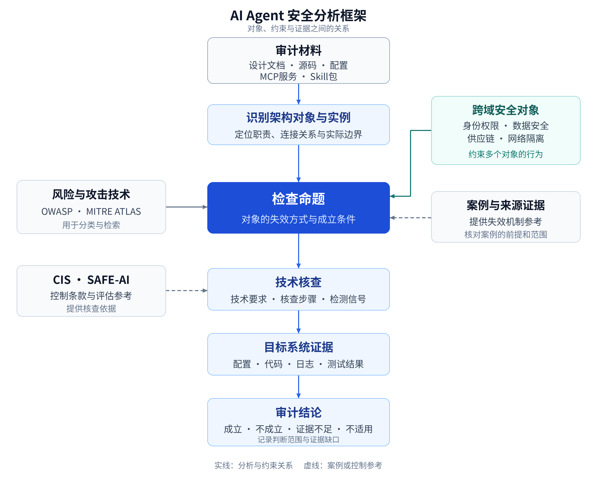

# AI Agent 安全分析框架初版尝试

## 研究现状

当前，AI Agent安全已经积累了大量研究和工程实践，但资料的组织方式仍然比较分散。有的工作研究提示注入、工具滥用或记忆投毒，有的整理风险清单，有的从架构出发做威胁建模，还有的提供治理要求、红队方法和运行时防护。它们使用的分析单位、覆盖范围和验证方法各不相同，放在一起时，很容易把风险、攻击技术、控制要求和测试结果混为一谈。

[GenAI Security Crosswalk](https://github.com/GenAI-Security-Project/crosswalk)直观地反映了这种现状。它围绕OWASP LLM、Agentic、Data Security和Agentic Skills四类目录的51项条目，组织了面向26种框架的77份映射文件。映射对象横跨治理合规、威胁建模、安全控制和验证要求。这里的26种框架各有用途，不能直接理解为26套相互竞争的Agent系统架构。

理解这些资料，首先需要分清它们各自回答什么问题：

| 资料类型与代表 | 主要回答的问题 | 用于具体系统审计时还需明确什么 |
|---|---|---|
| 风险目录：OWASP LLM、Agentic、Data Security、Skills | 应关注哪些类型的风险 | 风险在目标系统的哪个对象上、什么条件下成立 |
| 攻击技术知识库：MITRE ATLAS | 攻击者采用什么手段，怎样组织攻击步骤 | 目标是否具备相应入口、能力与可利用路径 |
| 架构与威胁建模：CIS Agent七层架构、MAESTRO | 系统怎样分解，威胁位于什么位置 | 实际组件、实例、连接关系和信任边界 |
| 治理与控制框架：NIST AI RMF、ISO管理体系、CIS Controls等 | 怎样组织风险管理，应落实哪些控制 | 条款如何转化为具体对象上的技术要求，以及由谁执行 |
| 验证与评估资料：ASVS、AISVS、SAFE-AI等 | 应验证哪些安全性质，怎样组织评估问题 | 取证方式、适用条件和结论判据 |
| Agent安全评测基准：AgentDojo、AgentDyn等 | 在给定任务、攻击面和判据下，系统表现如何 | 目标接口与状态如何适配，结果能够外推到什么范围 |

Crosswalk以OWASP风险条目为入口，将它们映射到其它框架的攻击技术、控制要求或架构层级，并提供案例和评测资源。用于审计具体系统时，还需要确定哪些组件涉及这些风险、应检查哪些代码与配置，以及用什么证据验证控制是否有效。

例如，同一个Skill注入问题可能同时出现在LLM风险、Agentic风险、Skills风险和ATLAS技术目录中；“访问控制”又可能对应记忆读取、工具调用、动作批准等不同检查。前者需要识别不同标签背后的共同机制，后者需要把宽泛控制细化到各自的执行点。把所有目录拼在一起，还不足以直接得到一份可执行的系统审计方案。

工程实践也呈现出不同侧重。NVIDIA OpenShell将沙箱、网络策略和凭据处理组织进运行时；Meta对Muse的安全介绍，则展开了主Agent、凭据服务、权限批准和持久状态之间的分离。[OpenShell项目说明](https://github.com/NVIDIA/OpenShell)、[Muse安全架构](https://research.meta.ai/blog/security-and-safety-for-ai-agents-our-approach-with-muse)

云厂商则从托管平台的角度提供Agent能力。[AWS AgentCore](https://docs.aws.amazon.com/bedrock-agentcore/latest/devguide/what-is-bedrock-agentcore.html)、[Microsoft Foundry](https://learn.microsoft.com/en-us/azure/foundry/agents/overview)、[Google Cloud Agent Platform](https://docs.cloud.google.com/gemini-enterprise-agent-platform/overview)围绕运行环境、身份权限、工具接入、记忆和可观测性提供可组合的服务。从这一平台视角看，安全分析还需要关注租户与会话隔离、企业身份接入、网络和数据访问约束，以及云厂商与使用方之间的责任划分。AWS在AgentCore安全文档中也明确采用了[共享责任模型](https://docs.aws.amazon.com/bedrock-agentcore/latest/devguide/security.html)。

比较这些方案，需要具体说明它们保护什么对象、在哪个位置执行控制、哪些路径实际受到约束，以及这些控制由开发者、企业管理员还是云服务商负责配置和验证。

编码Agent、个人助理和企业Agent经常共享这些能力，只是组合和部署方式不同。一个系统可以同时使用本地编排、远程模型、云端记忆和第三方MCP服务。安全分析既要覆盖提示注入、任务劫持等Agent相关机制，也要容纳认证错误、SSRF、依赖投毒、沙箱缺陷和数据隔离失败。统一分析需要建立在这些具体职责和失效机制之上。

## 新的尝试

我将这个框架做成了网页，托管在Netlify上，可以[直接在线浏览](https://fascinating-mousse-195475.netlify.app/)。框架以CIS七层Agent架构为基础，使用OWASP风险目录、MITRE ATLAS、CIS控制和[SAFE-AI](https://atlas.mitre.org/pdf-files/SAFEAI_Full_Report.pdf)等已有资料，重点解决这些资料与实际审计对象之间的衔接。具体设计集中在四点：

1. **用架构对象和跨域安全对象共同定位问题。** 七个主层细分为36个有明确职责的架构对象；身份权限、数据、供应链和网络隔离四个跨域主题描述需要贯穿多个对象的安全约束。组件负责什么，与组件连接后必须保持什么性质，可以分别分析。
2. **用检查命题连接风险、攻击技术和防御检测。** 一条命题描述某个对象在特定条件下的失效方式，并关联技术要求、核查步骤、检测信号和案例。多个风险标签可以引用同一命题，从而复用同一份机制描述和检查依据。
3. **用部署条件和证据可见性统一本地与云上分析。** 对象和失效命题保持可比较，实际实例、身份权限、控制执行方及责任归属按目标填写。同一项隔离要求可以用于自建服务和托管服务，取证方式与结论范围分别说明。
4. **让交互图谱和审计自动化共享结构化数据。** 对象、命题、风险关联、技术要求和案例由同一份JSON维护，HTML负责浏览，未来审计Skill直接读取数据。新增目录或案例时，可以复用已有分析单元，减少重复维护。

这些贡献体现在对象划分、关系建模和审计组织方式上。七层结构与来源目录沿用已有资料，逐对象的细化、关联和技术核查属于本框架的定义。

## 框架的组成

框架由架构对象、跨域安全对象、检查命题，以及防御与检测要求共同组成。架构对象定位职责，跨域对象表达贯穿多个组件的约束，检查命题将风险与具体核查连接起来。

### Agent系统架构

[CIS AI Agents Companion Guide](https://www.cisecurity.org/insights/white-papers/controls-v8-1-ai-agents-companion-guide)把Agent视为多组件应用，划分为接口、编排与规划、模型、工具与动作、记忆与知识、评测与可观测、基础设施七层。我采用这七个主层，是因为它们适合组织工程材料：接口文档、Agent配置、工具代码、记忆服务和运行环境都能找到对应位置。

不过，“工具与动作层存在风险”仍然太粗。工具目录被篡改、调用时没有检查权限、MCP协议处理存在缺陷、执行器拼接命令，分别需要查看不同的代码和证据。框架将七个主层细分为36个架构对象，作为分析和取证的落点。

| 主层 | 层内对象 |
|---|---|
| A1 接口层 | A1.1 API与消息接口；A1.2 内容解析与渲染；A1.3 会话管理 |
| A2 编排与规划层 | A2.1 任务与计划；A2.2 提示词与上下文配置；A2.3 编排引擎；A2.4 Agent定义与注册信息；A2.5 Skill与规则文件；A2.6 动作策略与审批组件；A2.7 协作通信与委派 |
| A3 模型层 | A3.1 模型与权重；A3.2 推理服务；A3.3 模型网关与代理；A3.4 训练与微调管线 |
| A4 工具与动作层 | A4.1 工具定义与能力目录；A4.2 工具调用器；A4.3 MCP宿主、客户端与服务端；A4.4 API与数据连接器；A4.5 浏览器与桌面工具；A4.6 代码与脚本执行器 |
| A5 记忆与知识层 | A5.1 对话历史与工作记忆；A5.2 长期记忆；A5.3 知识库与语料；A5.4 检索器与索引；A5.5 缓存与检查点；A5.6 数据存储服务；A5.7 数据摄取与处理管线 |
| A6 评测与可观测层 | A6.1 日志、追踪与遥测系统；A6.2 安全检测与护栏组件；A6.3 评测与红队系统 |
| A7 基础设施层 | A7.1 主机、容器与沙箱；A7.2 文件系统与工作区；A7.3 网络与出口代理；A7.4 身份与凭据设施；A7.5 构建、部署与配置系统；A7.6 硬件、驱动与计算组件 |

这里的“对象”需要保持适当抽象。一个确认按钮通常不足以成为独立对象，背后的动作审批机制才有相对稳定的职责。反过来，“工具系统”又太宽，无法指导取证。我的判断依据是：它是否有明确的职责和交接边界，能否从代码、文档或配置中识别，是否存在需要单独检查的失效方式，以及换一个产品后是否仍然有意义。

内容解析与渲染就是一个例子。它处理的是文档、Markdown、图表或富文本如何被解释和呈现，包括由此产生的脚本执行、资源加载与请求行为；这些职责值得单独分析。评测数据、评分规则与测试执行则放在评测与红队系统中，通过成员和具体命题区分，不要求每一种材料都成为同级对象。

七层表示功能归属。实际系统可以跳过某些对象，也可以由一个服务承担多个对象的职责。一个工具网关可能同时涉及能力目录、协议连接、调用授权和网络转发，不能因为产品名称里有“网关”，就把它整体塞进某一个格子。审计时仍需要识别实际实例以及它们的连接关系；当前知识库中的关联并不是某个目标系统已经确认的调用图。

### 跨域安全对象

按层整理可以定位组件，但很多安全属性需要沿连接关系检查。用户身份从接口传入编排器，再进入工具调用器，最终访问业务系统；其中任何一处把它替换成一个权限更大的服务账户，前面的认证都不足以说明最终动作得到了正确授权。

框架设置四个跨域主题，每个主题包含可识别的安全对象：

| 跨域主题 | 安全对象 | 需要贯穿检查的约束 |
|---|---|---|
| X1 身份权限安全 | 身份主体与服务账户、凭据与委派令牌、授权策略、授权与批准状态 | 最终动作仍由正确主体，在获准的资源、任务与批准范围内执行 |
| X2 数据安全 | 数据属性与来源信息、指令通道与信任边界、授权策略的数据访问视图、数据使用与外发策略、副本与保留配置 | 数据的归属、指令地位、使用范围和删除要求在传递与派生后得到保持 |
| X3 供应链安全 | 可信来源与信任根、制品与依赖、仓库与分发渠道、签名与来源证明、版本与更新配置 | 审核和信任决定对应实际加载的来源、内容、依赖与版本 |
| X4 网络隔离安全 | 网络可达策略、出口与目标约束 | 实际通信关系、出口路径，以及解析或跳转后的目标符合策略 |

当前共有15个规范跨域对象，另有1个共享视图。X2.3“授权策略（数据访问视图）”引用X1.3的统一授权策略，避免在身份安全和数据安全中各维护一份相同规则。

A7.3负责网络连接与转发设施，X4.1和X4.2描述这些设施应遵循的通信及目标约束。两者分别承载设施和策略的分析，避免在架构层与跨域主题中重复维护代理、网关等组件。分析时既要查看规则，也要验证工具、浏览器、子进程和其他通道是否真正受它约束。

跨域检查还需要确认实际的用户、租户、进程、凭据或管理方边界。两个对象属于不同层，不代表它们之间必然存在信任边界；同一层里的两个实例，也可能分别属于不同租户。四个主题用于组织重要约束，执行隔离、累计预算、停止与恢复等问题还通过联合核查覆盖。

### 检查命题

一条检查命题描述对象自身的一种失效方式，在数据中以`FM`（Failure Mode，失效模式）编号。风险目录通过编号引用它，技术要求和核查围绕它展开。多个目录可以从不同角度描述同一种失效机制，共享同一份命题及检查依据，避免每个标签各自维护一套近似说明。

例如，`FM-A2.5-01`描述“Skill指令或包内内容以超出授权的指令地位进入Agent决策”，关联了AST01、LLM01、ASI01和AML.T0110.000。它们从不同目录描述同一检查点，不应因为有四个标签，就算成四个独立漏洞。

这种关联需要逐项依据职责和机制判断。某个风险类别与一项攻击技术存在关联，并不能据此把这项技术挂到所有带有该风险标签的对象上。风险与其它框架之间的映射提供检索线索，对象上的命题说明要检查什么，目标系统的证据才用于判断命题是否成立。

整体关系可以用下面这张图表示。它描述的是分析和取证过程，不是Agent的运行时调用顺序。

一个命题至少要说清楚：哪个对象怎样失效，需要哪些条件，什么证据能够支持或否定这一判断，应满足什么技术要求，如何核查，以及运行中可以观察什么信号。以长期记忆为例，当前数据中的`FM-A5.2-03`针对“记忆命名空间或读取过滤混淆不同用户和租户”。

| 要素 | 这个命题如何落到检查上 |
|---|---|
| 对象 | A5.2 长期记忆 |
| 检查情境 | 多个用户或租户复用记忆服务，需要识别命名空间与实际主体的对应关系 |
| 失效判据 | 读取或更新没有被限制到正确主体的记忆范围 |
| 技术要求 | 记忆按用户与租户隔离，访问限制在服务端执行 |
| 取证材料 | 记忆主键与命名空间设计、访问过滤逻辑、跨主体读写结果 |
| 验证方式 | 建立两个测试主体，核对修改命名空间参数后的返回与写入结果，并保留正常访问作为对照 |
| 检测线索 | 记忆访问事件中的请求命名空间、实际身份和操作结果 |

这时，“系统有长期记忆”只是检查范围的线索。是否有缺陷，需要沿着主体绑定、过滤执行和实际返回继续取证。仅有一份设计文档，可以分析设计是否表达了隔离要求；若要判断实现是否有效，还需要代码、配置或行为证据。

这里也有一处当前版本还需继续完善的地方：部分命题的`conditions`把适用前提和缺陷成立条件放在一起。上表为了说明审计逻辑，将两者分开解释，数据字段还没有全面完成这种拆分。后续接入自动化流程时，必须避免把“检查后未发现缺陷”误判为“不适用”。

命题还带有在攻击路径中的角色：入口、风险定位、传播、执行外发、影响。这使同一个风险标签可以进一步解释为“不可信内容从哪里进入”“缺陷在哪个对象上成立”“影响经哪里扩散”“最后在哪里执行或外发”“哪些资产承受后果”。标签相同，不代表每个对象承担相同职责。

### 防御与检测

风险与对象的关联相对容易收敛，因为它可以围绕明确的失效机制来判断。防御关联则更容易泛化：“访问控制”“日志审计”“输入校验”适用于很多对象，直接把这些词挂上去，仍然不知道要检查什么。

当前框架把来源条款和技术检查分开维护。CIS Safeguards提供控制依据与条款索引；对象技术要求和逐命题核查说明具体要验证的行为；检测信号说明运行中需要观察什么。以访问控制为例，长期记忆要核对命名空间和读取过滤，工具调用器要核对最终动作权限，批准机制要核对批准内容与实际执行参数是否一致。它们可以共享控制来源，但检查方法应分别写清楚。

检测信号也需要说明可见性。有些异常可以从单个服务的日志直接判断，有些需要把用户身份、Agent任务、工具调用和出口请求关联起来，还有些在当前遥测下通常不可见。列出一条信号，并不等于某个部署已经能够产生它或据此告警。

跨对象的性质则通过联合核查处理。框架定义了九项，例如身份代表链末端的有效主体、批准与最终动作的绑定、出口收敛、加载时的来源校验链，以及停止、撤销与状态恢复。逐个组件通过检查之后，仍需要验证这些组件连起来的行为。

这也是从控制措施走向安全方案时的重要一步。假设系统配置了出口代理，还需要确认哪些调用确实经过代理，是否存在浏览器或子进程的其他出口，重定向后由谁重新判断目标，失败时是否切换到另一条路径。只有这些关系清楚，才能说明多个控制在具体系统中怎样共同发挥作用。

## 本地与云上部署的统一分析

AWS AgentCore把Runtime、Memory、Gateway、Identity等能力分别提供；Microsoft Foundry将Agent、会话和响应作为运行时组件，并提供预览中的托管记忆；Google的Agent Platform也区分运行时、会话、Memory Bank及身份和网关能力。这些服务可以按具体职责映射到同一套对象，产品打包方式和责任边界仍需逐项识别。[AWS组件说明](https://docs.aws.amazon.com/bedrock-agentcore/latest/devguide/what-is-bedrock-agentcore.html)、[Microsoft运行时组件](https://learn.microsoft.com/en-us/azure/foundry/agents/concepts/runtime-components)、[Google平台组件](https://docs.cloud.google.com/gemini-enterprise-agent-platform/overview)

例如，自建记忆服务和托管记忆服务都可以检查跨用户隔离。自建侧能够走查主键设计、过滤代码和数据库策略；托管侧可能只能查看可配置项、平台说明和测试接口。后者仍然可以进行跨用户行为验证，但无法据此断言已经审过服务内部实现。

自托管系统同样可能使用云身份、共享多个用户的数据，或者接入远程凭据服务。因此，“本地”与“云”不足以决定风险是否适用。实际审计要先记录部署与托管方式、自治程度、工具能力、数据范围、身份模型、外部内容来源、协作形态和扩展来源，再根据这些信息裁剪检查范围。

对象和失效命题保持可比较，实例、权限、可见证据及责任归属按部署填写。对象技术要求包含托管场景下的取证可见性说明。平台文档支持一项能力、目标已经启用该能力、实测证实它覆盖某条路径，是三种需要分别记录的证据状态。

## 应用示例：MarkItDown MCP

BlueRock披露的MarkItDown MCP研究，演示了工具接受任意URI后，在特定EC2部署中经元数据端点取得实例角色凭据的路径。其披露涉及可访问的IMDSv1与关联实例角色等条件，属于研究演示；不能把它推广为所有MCP服务或所有云端Agent都存在相同漏洞。[研究方原始披露](https://www.bluerock.io/post/mcp-furi-microsoft-markitdown-vulnerabilities)

项目以`INC-126`收录这条记录，直接挂载到A4.3“MCP宿主、客户端与服务端”和A7.3“网络与出口代理”：前者对应服务实现中的请求处理缺陷，后者对应运行环境实际可达的内部端点。

沿这条已披露路径继续开展目标审计时，可以提出下面这些问题。表中的后续检查是本框架的分析应用，不能直接当作研究方已经证实的额外漏洞。

| 分析位置 | 对目标系统要继续核对的内容 |
|---|---|
| A4.3 MCP实现 | 接收到的URI怎样变成请求，哪些协议和目标受到限制 |
| A7.3 网络设施 | 实际部署中哪些内部地址可达，请求最终经由什么路径发送 |
| X4.1、X4.2 网络约束 | 可达范围和目的地策略怎样约束这条请求路径，是否处理解析与重定向后的目标 |
| X1.2、X1.3 凭据与授权 | 运行环境是否能获得凭据，这些凭据的权限范围是什么 |
| A6.1 日志与遥测 | 能否把工具请求、实际连接目标和相关身份关联起来 |

一个“MCP安全扫描通过”的结果，只有明确了扫描对象和检查内容，才能放进这条证据链。同样，出口阻断可以限制某条利用路径，工具实现自身的问题仍有独立的修复位置。框架的作用，是把这些判断放回各自负责的对象上。

## 时间维度与评测方法

框架以架构对象和跨域约束组织分析，时间性则体现在具体的数据流、调用流和状态变化中。需要区分软件从开发到退役的工程周期、一次任务的执行过程，以及Agent实例、会话或持久状态的存续时间。它们具有不同边界，常驻助手、短任务Agent和动态子Agent也不必共享一套固定的生命周期阶段。

[LASM](https://arxiv.org/abs/2604.23338v2)用七层攻击面与四类时间性组织分析，为跨会话持续、状态累积和延迟触发等问题提供了参考。它的七层划分与CIS含义不同，层号不能直接互换。在本框架中，这类问题落实为沿具体路径的核查：内容何时写入，什么时候被重新读取，在哪个步骤取得指令地位，重启或新建会话后是否仍然存在，清理时是否覆盖缓存和派生副本。

选择评测方法时，应先明确要检查的安全问题。例如，验证外部内容中的恶意指令是否会让Agent偏离用户目标，可以参考[AgentDojo](https://arxiv.org/abs/2406.13352)和[AgentDyn](https://arxiv.org/abs/2602.03117)开展提示注入测试；验证长期记忆的用户隔离，需要用不同用户的身份进行读写测试；验证网络隔离，则需要核对出口配置并测试实际连接。这样，框架中的检查命题就能对应到具体的验证方法和证据。将评测基准用于真实系统时，还需要适配目标系统的工具接口、任务状态和结果判定规则，所得结论只覆盖实际测试过的条件与路径。

## 使用Agent审计Agent

我希望最终用Agent帮助分析Agent系统。审计对象可以是一份设计文档、一套源码、一个MCP服务、一个Skill包，也可以是实际部署。它们提供的证据能力不同：设计材料用于检查边界和控制是否被表达，源码用于检查实现路径，部署配置与运行结果用于验证实际生效情况。

当前框架可以支持下面这条审计工作路线，具体执行Skill仍待实现和验证：

1. 建立目标画像，确定部署方式、身份、能力和数据范围。
2. 从材料中识别对象及实例，记录调用、数据、权限和状态之间的实际关系。
3. 选取对象上的候选命题，结合目标情况判断适用范围，再检查相关跨域约束。
4. 按命题取证，选择代码走查、配置检查、接口测试、攻击回放或日志关联等方法。
5. 记录命题成立、不成立、证据不足或不适用，并说明证据、范围及责任归属。
6. 对出口、批准、身份代表链和状态恢复等性质补做联合核查。

审计Agent自身也需要纳入这些约束。被审计的代码、文档和Skill可能包含攻击性内容，它们进入审计上下文时应保持材料的指令地位；需要执行的测试应由审计流程决定，并限制相应工具权限。
